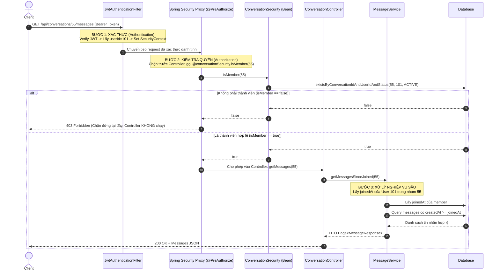

# Buổi 11: Security 2 & Chữa bài tập

## Chuyên đề: Phân quyền cấp tài nguyên (Object-Level Authorization) - Bài toán Kiểm tra thành viên nhóm chat

---

## Mục lục
- [I. Đặt vấn đề & Bản chất bài toán](#i-đặt-vấn-đề--bản-chất-bài-toán)
  - [1. Phân biệt Authentication và Authorization](#1-phân-biệt-authentication-và-authorization)
  - [2. Lỗ hổng bảo mật BOLA / IDOR là gì?](#2-lỗ-hổng-bảo-mật-bola--idor-là-gì)
  - [3. Nguyên tắc bất di bất dịch trong thiết kế](#3-nguyên-tắc-bất-di-bất-dịch-trong-thiết-kế)
- [II. Luồng xử lý tổng thể của hệ thống (Overall Architecture Flow)](#ii-luồng-xử-lý-tổng-thể-của-hệ-thống-overall-architecture-flow)
  - [1. Sơ đồ tuần tự (Sequence Diagram)](#1-sơ-đồ-tuần-tự-sequence-diagram)
  - [2. Chi tiết 6 bước trong Request Pipeline](#2-chi-tiết-6-bước-trong-request-pipeline)
- [III. Các cách tiếp cận & Mô hình kết hợp tối ưu (Hybrid Architecture)](#iii-các-cách-tiếp-cận--mô-hình-kết-hợp-tối-ưu-hybrid-architecture)
  - [1. So sánh 2 cách triển khai phổ biến](#1-so-sánh-2-cách-triển-khai-phổ-biến)
  - [2. Mô hình kết hợp chuẩn thực tế (Best Practice)](#2-mô-hình-kết-hợp-chuẩn-thực-tế-best-practice)
- [IV. Triển khai mã nguồn chi tiết với Spring Boot](#iv-triển-khai-mã-nguồn-chi-tiết-với-spring-boot)
  - [1. Thiết kế Entity và Repository](#1-thiết-kế-entity-và-repository)
  - [2. Tầng Security Bean (Cổng gác an ninh)](#2-tầng-security-bean-cổng-gác-an-ninh)
  - [3. Tầng Controller (Chặn người ngoài từ cửa với @PreAuthorize)](#3-tầng-controller-chặn-người-ngoài-từ-cửa-với-preauthorize)
  - [4. Tầng Service (Xử lý nghiệp vụ sâu - Lọc tin nhắn theo mốc gia nhập)](#4-tầng-service-xử-lý-nghiệp-vụ-sâu---lọc-tin-nhắn-theo-mốc-gia-nhập)
  - [5. Cấu hình kích hoạt Method Security](#5-cấu-hình-kích-hoạt-method-security)
- [V. Giải thích cơ chế hoạt động ngầm (Under The Hood) & Annotations](#v-giải-thích-cơ-chế-hoạt-động-ngầm-under-the-hood--annotations)
  - [1. Cơ chế AOP Proxy của @PreAuthorize](#1-cơ-chế-aop-proxy-của-preauthorize)
  - [2. Cú pháp SpEL (Spring Expression Language)](#2-cú-pháp-spel-spring-expression-language)
  - [3. Ý nghĩa các Annotation cốt lõi](#3-ý-nghĩa-các-annotation-cốt-lõi)
- [VI. Mở rộng & Tối ưu hóa hiệu năng trong hệ thống thực tế](#vi-mở-rộng--tối-ưu-hóa-hiệu-năng-trong-hệ-thống-thực-tế)
  - [1. Tối ưu tầng kiểm tra quyền với Redis Set](#1-tối-ưu-tầng-kiểm-tra-quyền-với-redis-set)
  - [2. Kiểm tra quyền Realtime trên WebSocket / STOMP](#2-kiểm-tra-quyền-realtime-trên-websocket--stomp)
  - [3. Chiến lược phản hồi: 403 Forbidden vs 404 Not Found](#3-chiến-lược-phản-hồi-403-forbidden-vs-404-not-found)

---

## I. Đặt vấn đề & Bản chất bài toán

Khi người dùng gửi yêu cầu lấy lịch sử một cuộc hội thoại nhóm qua API:
```http
GET /api/conversations/{conversationId}/messages
Authorization: Bearer <jwt_token>
```
Đây không đơn thuần là bài toán kiểm tra xem người dùng đã đăng nhập hay chưa, mà là bài toán **kiểm tra quyền truy cập trên một đối tượng cụ thể** trong hệ thống.

### 1. Phân biệt Authentication và Authorization

- **Authentication (Xác thực danh tính):** Trả lời câu hỏi *"Bạn là ai?"*. Hệ thống giải mã Token / Session để xác định `userId` của người gửi.
- **Authorization (Ủy quyền / Phân quyền):** Trả lời câu hỏi *"Bạn có được phép thao tác/đọc dữ liệu trên tài nguyên này không?"*. Hệ thống đối chiếu `userId` với `conversationId` xem có mối quan hệ hợp lệ hay không.

### 2. Lỗ hổng bảo mật BOLA / IDOR là gì?

Nếu hệ thống chỉ xác thực JWT (biết user đã đăng nhập) rồi lập tức chạy query:
```sql
SELECT * FROM messages WHERE conversation_id = :conversationId
```
Thì bất kỳ ai đã đăng nhập đều có thể đổi `{conversationId}` trên URL thành ID của nhóm khác để đọc trộm tin nhắn nội bộ.
- Đây chính là lỗ hổng **BOLA** (*Broken Object Level Authorization*) hay **IDOR** (*Insecure Direct Object References*) - đứng **Vị trí số 1 trong Top 10 lỗ hổng API nguy hiểm nhất của OWASP**.

### 3. Nguyên tắc bất di bất dịch trong thiết kế

> [!IMPORTANT]
> `userId` của người yêu cầu **phải luôn được trích xuất từ Token/Session đã được Server ký số** (từ `SecurityContext`), **tuyệt đối không bao giờ nhận qua Request Body, Param hay Header tự định nghĩa** do Client gửi lên.

---

## II. Luồng xử lý tổng thể của hệ thống (Overall Architecture Flow)

### 1. Sơ đồ tuần tự (Sequence Diagram)

Giả sử:
- **Người dùng:** Nguyễn Văn A có `userId = 101`.
- **Nhóm chat cần xem:** `conversationId = 55`.
- **Request:** `GET /api/conversations/55/messages` kèm Bearer Token.



### 2. Chi tiết 6 bước trong Request Pipeline

1. **Bước 1 (Xác thực tại Filter Chain):** `JwtAuthenticationFilter` chặn request, bóc tách token, kiểm tra chữ ký và hạn dùng. Nếu hợp lệ, lưu `userId = 101` vào `SecurityContextHolder`. Nếu giả mạo hoặc hết hạn, ngắt ngay với `401 Unauthorized`.
2. **Bước 2 (Chặn ngoài cửa bằng AOP Proxy):** Trước khi vào Controller, Spring AOP chặn lại để đánh giá biểu thức `@PreAuthorize`.
3. **Bước 3 (Kiểm tra quan hệ thành viên):** Bean an ninh gọi truy vấn kiểm tra xem `userId = 101` có nằm trong danh sách thành viên `status = ACTIVE` của nhóm `55` hay không.
4. **Bước 4 (Rẽ nhánh bảo vệ - Fail Fast):**
   - Nếu `false`: Ném `AccessDeniedException` $\rightarrow$ Client nhận `403 Forbidden`. Hàm Controller và Service không được chạy.
   - Nếu `true`: Cho phép đi tiếp vào Controller.
5. **Bước 5 (Xử lý nghiệp vụ sâu tại Service):** Service tìm thời điểm người dùng vào nhóm (`joinedAt`), sau đó chỉ truy vấn những tin nhắn được gửi từ thời điểm đó trở đi.
6. **Bước 6 (Phản hồi dữ liệu):** Map dữ liệu Entity sang DTO và trả về HTTP `200 OK` kèm dữ liệu phân trang.

---

## III. Các cách tiếp cận & Mô hình kết hợp tối ưu (Hybrid Architecture)

### 1. So sánh 2 cách triển khai phổ biến

| Tiêu chí so sánh | Cách 1: Kiểm tra thủ công trong Service | Cách 2: Dùng `@PreAuthorize` (Method Security) |
| :--- | :--- | :--- |
| **Bản chất** | Lập trình mệnh lệnh (Imperative) | Lập trình khai báo (Declarative / AOP) |
| **Vị trí chặn** | Nằm sâu bên trong tầng Service | Nằm ngay ngoài cửa trước khi vào Controller |
| **Độ sạch mã nguồn (Clean Code)** | Logic an ninh và nghiệp vụ bị trộn lẫn | Tách bạch hoàn toàn: Controller lo cổng gác, Service lo nghiệp vụ |
| **Khả năng tái sử dụng** | Thấp, phải gọi hàm check ở từng method Service | **Rất cao**, chỉ cần 1 dòng annotation cho mọi API liên quan |
| **Nguy cơ sót lỗi** | Dễ quên gọi hàm check quyền khi code vội | Rất khó sót vì nhìn vào Controller là thấy trạng thái bảo vệ |
| **Khả năng xử lý nghiệp vụ sâu** | **Rất linh hoạt** (lấy dữ liệu phụ, lọc nhánh rẽ) | Bị hạn chế vì chỉ trả về boolean (`true`/`false`) |

### 2. Mô hình kết hợp chuẩn thực tế (Best Practice)

Thay vì chọn 1 trong 2, các kiến trúc sư phần mềm kết hợp sức mạnh của cả hai:
- **Tầng Controller (Dùng Cách 2):** Đóng vai trò **Người gác cổng (Gatekeeper)** dùng `@PreAuthorize` chặn đứng ngay lập tức người ngoài nhóm.
- **Tầng Service (Dùng Cách 1):** Đóng vai trò **Người xử lý nghiệp vụ**. Vì đã có cổng gác bảo đảm 100% người vào là thành viên, Service chỉ việc xử lý nghiệp vụ sâu: *lấy `joinedAt`, kiểm tra role (Admin/Member), phân trang tin nhắn*.

---

## IV. Triển khai mã nguồn chi tiết với Spring Boot

### 1. Thiết kế Entity và Repository

#### a. `ConversationMember.java` (Lưu quan hệ thành viên và mốc tham gia)
```java
@Entity
@Table(name = "conversation_members")
@Getter 
@Setter 
@NoArgsConstructor
public class ConversationMember {
    @Id
    @GeneratedValue(strategy = GenerationType.IDENTITY)
    private Long id;

    @ManyToOne(fetch = FetchType.LAZY)
    @JoinColumn(name = "conversation_id", nullable = false)
    private Conversation conversation;

    @ManyToOne(fetch = FetchType.LAZY)
    @JoinColumn(name = "user_id", nullable = false)
    private User user;

    @Column(name = "joined_at", nullable = false)
    private LocalDateTime joinedAt; // Mốc thời gian được thêm vào nhóm

    @Enumerated(EnumType.STRING)
    @Column(nullable = false)
    private MemberStatus status; // ACTIVE, LEFT, BANNED
}
```

#### b. `ConversationMemberRepository.java`
```java
public interface ConversationMemberRepository extends JpaRepository<ConversationMember, Long> {
    
    // Dùng cho tầng Controller (@PreAuthorize) kiểm tra nhanh sự tồn tại
    boolean existsByConversationIdAndUserIdAndStatus(Long conversationId, Long userId, MemberStatus status);

    // Dùng cho tầng Service lấy chi tiết mốc thời gian joinedAt
    Optional<ConversationMember> findByConversationIdAndUserIdAndStatus(Long conversationId, Long userId, MemberStatus status);
}
```

#### c. `MessageRepository.java`
```java
public interface MessageRepository extends JpaRepository<Message, Long> {

    // Nghiệp vụ: Chỉ lấy tin nhắn được gửi KỂ TỪ KHI thành viên gia nhập nhóm
    @Query("""
        SELECT m FROM Message m 
        JOIN FETCH m.sender 
        WHERE m.conversation.id = :conversationId 
          AND m.createdAt >= :joinedAt 
        ORDER BY m.createdAt DESC
    """)
    Page<Message> findMessagesSinceJoined(
        @Param("conversationId") Long conversationId, 
        @Param("joinedAt") LocalDateTime joinedAt, 
        Pageable pageable
    );
}
```

---

### 2. Tầng Security Bean (Cổng gác an ninh)

Bean này chỉ trả về `true` (cho phép) hoặc `false` (từ chối).

```java
@Component("conversationSecurity")
@RequiredArgsConstructor
public class ConversationSecurity {

    private final ConversationMemberRepository memberRepository;

    public boolean isMember(Long conversationId) {
        // Lấy userId hiện tại từ Token thông qua SecurityContext
        Long currentUserId = SecurityUtils.getCurrentUserId();
        if (currentUserId == null || conversationId == null) {
            return false;
        }

        return memberRepository.existsByConversationIdAndUserIdAndStatus(
                conversationId, 
                currentUserId, 
                MemberStatus.ACTIVE
        );
    }
}
```

---

### 3. Tầng Controller (Chặn người ngoài từ cửa với @PreAuthorize)

```java
@RestController
@RequestMapping("/api/conversations")
@RequiredArgsConstructor
public class ConversationController {

    private final MessageService messageService;

    @GetMapping("/{id}/messages")
    @PreAuthorize("@conversationSecurity.isMember(#id)") // <-- CỔNG GÁC CHẶN NGAY TỪ CỬA
    public ResponseEntity<Page<MessageResponse>> getMessages(
            @PathVariable("id") Long id,
            @PageableDefault(size = 20) Pageable pageable
    ) {
        // Chỉ khi isMember(#id) trả về TRUE thì code bên trong này mới được chạy
        return ResponseEntity.ok(messageService.getMessagesSinceJoined(id, pageable));
    }
}
```

---

### 4. Tầng Service (Xử lý nghiệp vụ sâu - Lọc tin nhắn theo mốc gia nhập)

Code Service hoàn toàn không cần `if (!isMember) throw 403` vì Controller đã làm việc đó. Service chỉ tập trung xử lý đúng nghiệp vụ:

```java
@Service
@RequiredArgsConstructor
public class MessageService {

    private final ConversationMemberRepository memberRepository;
    private final MessageRepository messageRepository;

    @Transactional(readOnly = true)
    public Page<MessageResponse> getMessagesSinceJoined(Long conversationId, Pageable pageable) {
        Long currentUserId = SecurityUtils.getCurrentUserId();

        // 1. Lấy thông tin thành viên để lấy mốc joinedAt
        ConversationMember member = memberRepository
                .findByConversationIdAndUserIdAndStatus(conversationId, currentUserId, MemberStatus.ACTIVE)
                .orElseThrow(() -> new IllegalStateException("Dữ liệu không đồng bộ: Thành viên không tồn tại"));

        // 2. Nghiệp vụ sâu: Truy vấn tin nhắn tính từ lúc user vào nhóm trở đi
        Page<Message> messages = messageRepository.findMessagesSinceJoined(
                conversationId, 
                member.getJoinedAt(), 
                pageable
        );

        // 3. Map sang DTO trả về
        return messages.map(MessageResponse::fromEntity);
    }
}
```

---

### 5. Cấu hình kích hoạt Method Security

Trong Spring Boot 3 / Spring Security 6, bắt buộc phải khai báo annotation `@EnableMethodSecurity`:

```java
@Configuration
@EnableWebSecurity
@EnableMethodSecurity // <-- BẮT BUỘC: Kích hoạt @PreAuthorize
public class SecurityConfig {

    @Bean
    public SecurityFilterChain filterChain(HttpSecurity http) throws Exception {
        http
            .csrf(AbstractHttpConfigurer::disable)
            .authorizeHttpRequests(auth -> auth
                .requestMatchers("/api/auth/**").permitAll()
                .anyRequest().authenticated()
            );
        return http.build();
    }
}
```

---

## V. Giải thích cơ chế hoạt động ngầm (Under The Hood) & Annotations

### 1. Cơ chế AOP Proxy của @PreAuthorize

Khi bạn khai báo `@PreAuthorize`:
1. Spring khởi tạo một **Lớp vỏ bọc (Dynamic Proxy)** bao quanh `ConversationController`.
2. Mọi cuộc gọi HTTP đến Controller thực chất đều đi vào Proxy trước.
3. Proxy dùng `MethodSecurityInterceptor` chặn lại, tính toán biểu thức bên trong `@PreAuthorize`.
4. Nếu kết quả là `false`: Ném `AccessDeniedException` ngay tức khắc. **Code bên trong method Controller hoàn toàn không được thực thi (Fail-Fast)**.

### 2. Cú pháp SpEL (Spring Expression Language)

Biểu thức: `@conversationSecurity.isMember(#id)`

```
     @conversationSecurity  .  isMember  (  #id  )
     ─────────────────────     ────────     ────
               │                   │          │
   Tìm Bean có tên là              │      Lấy giá trị của biến `id`
   "conversationSecurity"          │      truyền vào từ @PathVariable
                             Gọi phương thức
```

- **Ký tự `@`**: Báo cho Spring tìm kiếm một **Spring Bean** trong ApplicationContext.
- **Ký tự `#`**: Báo cho Spring trích xuất **giá trị của tham số hàm** tương ứng.

### 3. Ý nghĩa các Annotation cốt lõi

- **`@Component("conversationSecurity")`**: Đăng ký class thành Bean với định danh rõ ràng để SpEL có thể tra cứu.
- **`@PathVariable("id") Long id`**: Ánh xạ biến động `{id}` trên đường dẫn URL thành biến Java.
- **`@RequiredArgsConstructor`** *(Lombok)*: Tự sinh constructor chứa các trường `final`, phục vụ cơ chế Dependency Injection (DI) chuẩn của Spring mà không cần dùng `@Autowired`.

---

## VI. Mở rộng & Tối ưu hóa hiệu năng trong hệ thống thực tế

### 1. Tối ưu tầng kiểm tra quyền với Redis Set

#### a. Vấn đề
Trong ứng dụng chat có hàng triệu tin nhắn mỗi ngày, nếu mỗi tin nhắn gửi lên hoặc load lịch sử đều phải chạy câu lệnh `SELECT COUNT(*)` xuống database quan hệ thì database sẽ nhanh chóng bị nghẽn I/O.

#### b. Giải pháp: Redis Set
- **Cấu trúc dữ liệu:** Lưu danh sách `userId` của mỗi nhóm chat dưới dạng **Redis Set** (Key: `conversation:{id}:members`).
- **Ưu điểm vượt trội:**
  - Chạy trên **RAM của Server** với độ phức tạp **$O(1)$**.
  - Kiểm tra quyền tức thì bằng lệnh:
    ```bash
    SISMEMBER conversation:55:members 101
    ```
    *(Trả về `1` nếu là thành viên, `0` nếu không phải)*.
  - Tự động chống trùng lặp `userId`.

### 2. Kiểm tra quyền Realtime trên WebSocket / STOMP

Khi người dùng tham gia chat thời gian thực qua giao thức **WebSocket**:
- **Bắt tay kết nối ban đầu (Handshake):** Thực hiện xác thực Authentication (kiểm tra JWT Token).
- **Lắng nghe tin nhắn (Subscribe Topic):** Người dùng đăng ký nghe topic `/topic/conversation.55`.
- **Cơ chế bảo vệ:** Cài đặt `ChannelInterceptor` của Spring WebSocket. Khi bắt gặp sự kiện `SUBSCRIBE`:
  ```java
  if (StompCommand.SUBSCRIBE.equals(accessor.getCommand())) {
      Long conversationId = extractIdFromDestination(accessor.getDestination());
      Long userId = extractUserId(accessor.getUser());
      if (!conversationSecurity.isMember(conversationId, userId)) {
          throw new AccessDeniedException("Không có quyền subscribe vào phòng chat này");
      }
  }
  ```

### 3. Chiến lược phản hồi: 403 Forbidden vs 404 Not Found

| Mã lỗi HTTP | Khi nào nên dùng? | Đánh giá an ninh |
| :--- | :--- | :--- |
| **`403 Forbidden`** | Nhóm công khai, hoặc hệ thống nội bộ doanh nghiệp. | Chuẩn ngữ nghĩa RESTful, nhưng để lộ thông tin rằng *nhóm này có tồn tại* trên hệ thống. |
| **`404 Not Found`** | Nhóm chat riêng tư, dữ liệu nhạy cảm cao. | **Bảo mật hơn**. Tránh được kỹ thuật tấn công dò quét ID (Enumeration Attack) vì kẻ tấn công không biết ID đó có tồn tại hay không. |
