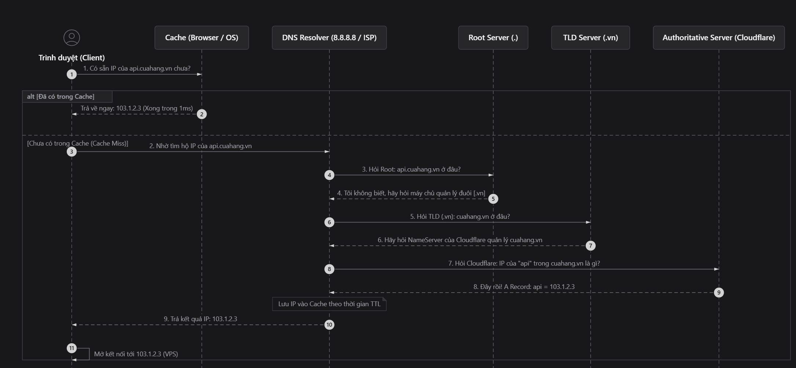
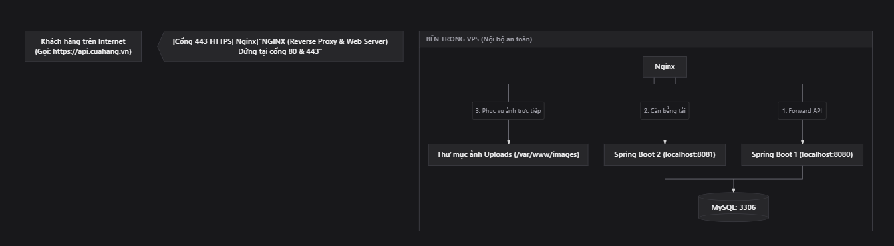

# BUỔI 12: QUY TRÌNH DEPLOY CƠ BẢN
(Tìm hiểu các kiến thức cơ bản về quy trình triển khai một dự án BE lên VPS)

## I. Tổng quan Deploy: Deploy là gì? Quy trình các bước khi deploy một dự án.
### 1. Khái niệm
- Deploy (triển khai) là quá trình đưa ứng dụng phần mềm, website từ môi trường local (máy cá nhân, máy dev) lên môi trường thực tế để người dùng cuối có thể truy cập và sử dụng
### 2. Quy trình các bước khi deploy 1 dự án
- **Chuẩn bị mã nguồn**: Đảm bảo mã nguồn đã được kiểm tra, đóng gói và sẵn sàng để triển khai
- **Chuẩn bị môi trường**: Xác định môi trường mục tiêu có thể là máy chủ phát triển (development), thử nghiệm (stagging), sản xuất (prodiction) 
- **Cấu hình môi trường**: Thiết lập các yếu tố cần thiết trên máy chủ như cơ sở dữ liệu, biến môi trường, và các dịch vụ phụ trợ.
- **Tải mã nguồn lên**: Sử dụng các công cụ hoặc phương pháp để đưa mã nguồn từ máy phát triển lên máy chủ đích.
- **Kiểm thử**: Chạy các bài kiểm tra tự động và thủ công để đảm bảo ứng dụng hoạt động đúng như mong đợi trên môi trường mới.
- **Vận hành và giám sát**: Đưa ứng dụng vào hoạt động chính thức và theo dõi hiệu suất, phát hiện và khắc phục sự cố kịp thời.
## II. VPS và SSH: VPS là gì? SSH là gì? Cách kết nối và thao tác với VPS thông qua SSH. Một số lệnh Linux cơ bản.
### 1. VPS (Virtual Private Server)
- Là một máy chủ ảo được tách ra từ một máy chủ vật lý. Mỗi VPS có CPU, RAM, ổ cứng và hệ điều hành riêng, hoạt động độc lập với nhau.
- Hiểu một cách đơn giản nhất: VPS giống như một chiếc máy tính (thường chạy hệ điều hành Linux) đặt ở trung tâm dữ liệu, có mạng Internet tốc độ cao, có địa chỉ IP Public riêng và KHÔNG BAO GIỜ TẮT.
- VPS có tác dụng gì?
    - Chạy hệ thống 24/7 thay cho máy tính cá nhân
    - Toàn quyền kiểm soát hệ thống của bạn
    - Tài nguyên riêng biệt và bảo mật
    - Dễ dàng nâng cấp và tiết kiệm chi phí
### 2. SSH (Secure Shell)
- 
### 3. Cách kết nối và thao tác với VPS thông qua SSH

### 4. Một số lệnh Linux cơ bản
#### 4.1 Nhóm lệnh di chuyển và xem thư mục 
| Lệnh | Tác dụng | Ví dụ & Ghi chú |
| --- | --- | --- |
| `pwd` | Xem đường dẫn thư mục hiện tại bạn đang đứng (Print Working Directory). | Kết quả vd: `/home/ubuntu/my-project` |
| `ls` | Liệt kê các file và thư mục đang có. | `ls -la`: Liệt kê chi tiết kèm cả file ẩn (như `.env`, `.git` - rất hay dùng!). |
| `cd` | Di chuyển vào thư mục khác (Change Directory). | `cd /opt/app` (vào thư mục app)<br>`cd ..` (lùi ra ngoài 1 cấp)<br>`cd ~` (về thư mục gốc của user) |
| `mkdir` | Tạo thư mục mới (Make Directory). | `mkdir backend` (tạo 1 thư mục)<br>`mkdir -p app/logs` (tạo nhiều cấp lồng nhau) |
#### 4.2 Nhóm lệnh Thao tác File, Soạn thảo & Đọc Log
| Lệnh | Tác dụng | Ví dụ & Ghi chú |
| --- | --- | --- |
| `touch` | Tạo một file rỗng mới. | `touch .env` |
| `cp` | Copy file hoặc thư mục. | `cp .env .env.backup` (copy file)<br>`cp -r folderA folderB` (copy cả thư mục) |
| `mv` | Di chuyển file hoặc Đổi tên file. | `mv oldname.txt newname.txt` |
| `rm` | Xóa file hoặc thư mục. | `rm test.txt` (xóa file)<br>`rm -rf folder` (Cẩn thận: xóa vĩnh viễn thư mục, không vào thùng rác!) |
| `cat` | In toàn bộ nội dung file ra màn hình (dùng cho file ngắn). | `cat .env` hoặc `cat docker-compose.yml` |
| `tail` | Xem các dòng cuối cùng của file (chuyên dùng đọc file Log). | `tail -f app.log`: Xem log chạy trực tiếp theo thời gian thực (nhấn `Ctrl + C` để thoát). |
| `nano` | Mở trình soạn thảo văn bản ngay trên Terminal (dễ dùng nhất cho người mới). | `nano .env` (để sửa biến môi trường)<br>Mẹo lưu & thoát `nano`: Nhấn `Ctrl + O` → `Enter` (lưu) → `Ctrl + X` (thoát). |
#### 4.3 Nhóm lệnh Quyền hạn & Quản trị
| Lệnh | Tác dụng | Ví dụ & Ghi chú |
| --- | --- | --- |
| `sudo` | Chạy lệnh với quyền Quản trị viên cao nhất (`root`). | `sudo apt update`, `sudo systemctl restart nginx` |
| `chmod` | Cấp quyền Đọc / Ghi / Thực thi cho file. | `chmod +x deploy.sh` (cấp quyền chạy cho file script)<br>`chmod 600 ~/.ssh/id_rsa` (chỉ chủ sở hữu được đọc/ghi file key SSH) |
#### 4.4 Nhóm lệnh Cài phần mềm & Quản lý dịch vụ (trên Ubuntu/Debian)
| Lệnh | Tác dụng | Ví dụ & Ghi chú |
| --- | --- | --- |
| `apt update` | Cập nhật danh sách các gói phần mềm mới nhất trên Ubuntu. | Luôn chạy `sudo apt update` trước khi cài phần mềm mới. |
| `apt install` | Cài đặt phần mềm mới lên VPS. | `sudo apt install nginx git -y` |
| `systemctl` | Bật, tắt, khởi động lại hoặc kiểm tra trạng thái các dịch vụ chạy ngầm (Nginx, Docker, MySQL...). | `sudo systemctl status nginx` (xem đang chạy hay chết)<br>`sudo systemctl restart nginx` (khởi động lại sau khi sửa config)<br>`sudo systemctl enable docker` (tự chạy khi VPS khởi động lại) |

## III. Docker: Docker là gì? Image, Container, Dockerfile và Docker Compose là gì?
### 1. Docker là gì
- Docker là một nền tảng mã nguồn mở cho phép bạn đóng gói ứng dụng của mình cùng với toàn bộ môi trường chạy của nó (hệ điều hành siêu nhẹ, Java, thư viện, cấu hình...) vào một "chiếc hộp kín" gọi là Container.

- Nhờ chiếc hộp này, ứng dụng của bạn sẽ chạy hoàn toàn giống nhau 100% trên bất kỳ máy tính nào (từ laptop Windows của bạn, máy Mac của đồng đội cho đến máy chủ Linux VPS ngoài đời).

- Khẩu hiệu nổi tiếng nhất của Docker là: "Build Once, Run Anywhere" (Đóng gói một lần, chạy ở bất cứ đâu).

- Docker khác gì Máy ảo truyền thống (VMware / VirtualBox)?
| Tiêu chí | Máy ảo truyền thống (VMware, VirtualBox) | Docker Container |
| --- | --- | --- |
| Cơ chế hoạt động | Cài đặt hẳn một Hệ điều hành đầy đủ riêng biệt (Guest OS) bên trong, ngốn rất nhiều tài nguyên. | Dùng chung Nhân hệ điều hành (Kernel) với máy chủ thật, chỉ đóng gói đúng những gì ứng dụng cần. |
| Dung lượng | Cực kỳ nặng (vài GB đến hàng chục GB cho 1 máy ảo). | Siêu nhẹ (chỉ vài chục MB đến vài trăm MB). |
| Thời gian khởi động | Chậm (mất vài phút để khởi động xong hệ điều hành). | Gần như tức thì (chỉ mất 1 đến vài giây). |
| Số lượng chạy được | Chạy 2–3 máy ảo là máy tính cá nhân bắt đầu đơ giật. | Có thể chạy hàng chục container cùng lúc trên máy bình thường. |

### 2. Image
- Docker Image là một file đóng gói "bất biến" (chỉ đọc - Read-only) chứa tất cả những gì cần thiết để ứng dụng có thể chạy: mã nguồn code, phiên bản Java, hệ điều hành Linux tối giản, các thư viện phụ thuộc và file cấu hình
- Tính chất: Nó nằm yên trên ổ cứng (hoặc lưu trên kho Docker Hub). Bản thân Image không chạy, không tốn CPU và không tốn RAM.
- Hình ảnh ví von:
    - Giống như Bản vẽ thiết kế ngôi nhà nằm trên giấy.
    - Giống như Chiếc khuôn đúc bánh bằng kim loại.
### 3. Container
- Docker Container là một thực thể (instance) sống động đang thực sự chạy được sinh ra từ một Docker Image.

- Tính chất: Nó đang hoạt động trong bộ nhớ RAM, có tiến trình chạy ngầm, có địa chỉ IP riêng, có thể nhận dữ liệu mạng và tiêu tốn CPU/RAM của máy tính.
- Bạn có thể thoải mái Bật (Start), Tắt (Stop), Khởi động lại (Restart) hoặc Xóa bỏ (Delete) một Container mà không làm ảnh hưởng gì đến file Image gốc.
- Hình ảnh ví von:
    - Giống như Ngôi nhà thật được xây lên từ bản vẽ (có người vào ở, bật đèn, mở nước).
    - Giống như Chiếc bánh thật được đúc ra từ khuôn (bạn có thể ăn, cắt nhỏ, rắc đường lên).

### 4. Dockerfile
- Dockerfile là một file văn bản thuần túy (file text, không có đuôi mở rộng) chứa tập hợp các câu lệnh hướng dẫn từng bước để Docker tự động đóng gói và tạo ra một Docker Image.

- Nếu coi:
    - Docker Container là Món ăn đã nấu chín đang dọn trên bàn,
    - Docker Image là Hộp thức ăn chế biến sẵn đóng băng,
    - Thì Dockerfile chính là "Tờ giấy ghi công thức nấu ăn"!
- Vòng đời từ Dockerfile đến Docker Container
```
[ Dockerfile ]──(Lệnh: docker build)──▶[ Docker Image ]──(Lệnh: docker run)──▶[ Docker Container ]
(Công thức viết ra)                 (Bản đóng gói tĩnh)                (Ứng dụng đang chạy trong RAM)
 ```
- VD
```bash
# Bước 1: Chọn một "móng nhà" có sẵn (Linux Alpine siêu nhẹ đã cài sẵn Java 21)
FROM eclipse-temurin:21-jre-alpine

# Bước 2: Tạo một thư mục làm việc bên trong chiếc hộp tên là /app (tương đương lệnh cd /app)
WORKDIR /app

# Bước 3: Copy file .jar đã build từ máy tính của bạn ném vào thư mục /app bên trong hộp
COPY target/bandichvu-0.0.1.jar app.jar

# Bước 4: Báo cho Docker biết ứng dụng này sẽ lắng nghe ở cổng 8080
EXPOSE 8080

# Bước 5: Câu lệnh mặc định sẽ tự động chạy khi Container được bật lên
ENTRYPOINT ["java", "-jar", "app.jar"]
```
- Bảng từ khóa trong Dockerfile:

| Từ khóa | Ý nghĩa dễ hiểu | Ví dụ thực tế |
| --- | --- | --- |
| `FROM` | Móng nhà / Base Image: Bắt buộc là dòng đầu tiên của mọi Dockerfile, dùng để chọn môi trường nền (ví dụ: cần Java, cần Node.js hay cần Python). | `FROM openjdk:21`<br>`FROM node:20-alpine` |
| `WORKDIR` | Chuyển thư mục làm việc: Giống lệnh `cd`, tất cả các lệnh bên dưới sẽ được thực thi tại thư mục này. | `WORKDIR /app` |
| `COPY` | Chép file từ ngoài vào trong: Copy file code từ máy tính của bạn bỏ vào bên trong chiếc hộp. | `COPY target/*.jar app.jar` |
| `RUN` | Chạy lệnh khi BUILD Image: Dùng để cài thêm phần mềm hoặc tải thư viện lúc đang đóng gói. | `RUN apt-get update && apt-get install -y curl` |
| `ENV` | Cài biến môi trường: Thiết lập các giá trị cố định bên trong Image. | `ENV SPRING_PROFILES_ACTIVE=prod` |
| `EXPOSE` | Khai báo cổng: Nói cho người dùng biết container này mở cổng số mấy (chỉ mang tính thông báo). | `EXPOSE 8080` |
| `CMD` / `ENTRYPOINT` | Lệnh khởi động: Câu lệnh sẽ được gõ khi bật Container lên (chỉ chạy lúc `docker run`, không chạy lúc `docker build`). | `CMD ["java", "-jar", "app.jar"]` |
### 5. Docker Compose
- Nếu Dockerfile dùng để đóng gói 1 dịch vụ riêng lẻ (ví dụ: chỉ đóng gói mình thằng Spring Boot), thì **Docker Compose** là công cụ giúp bạn quản lý và khởi chạy NHIỀU Container cùng một lúc chỉ bằng DUY NHẤT MỘT câu lệnh.

- Trong thế giới Docker, Docker Compose được ví như một "Vị nhạc trưởng" điều khiển cả một dàn nhạc giao hưởng (gồm Spring Boot, MySQL, Redis, Nginx...) cùng hòa âm nhịp nhàng với nhau!

- **Nỗi khổ nếu KHÔNG dùng Docker Compose (Tại sao nó phải ra đời?)**
    - Một dự án Web thực tế không bao giờ chạy một mình. Thông thường bạn sẽ có:
        - Một Container chạy Backend Spring Boot.
        - Một Container chạy Database MySQL.
        - Một Container chạy Redis Cache.

    - Nếu không có Docker Compose: Mỗi lần bật máy hoặc deploy lên VPS, bạn phải gõ cả đống lệnh dòng lệnh dài dằng dặc:
        - Phải gõ lệnh tạo mạng ảo: docker network create ...
        - Phải gõ lệnh chạy MySQL: docker run -d --name mysql -p 3306:3306 -e MYSQL_ROOT_PASSWORD=123 -v ... mysql:8.0
        - Phải gõ lệnh chạy Redis: docker run -d --name redis -p 6379:6379 ...
        - Phải gõ lệnh chạy Spring Boot: docker run -d --name backend -p 8080:8080 ...
    → Vấn đề: Quá dài dòng, dễ gõ nhầm một dấu cách là lỗi, và phải tự nhớ thứ tự bật MySQL trước rồi mới được bật Spring Boot.

- **Docker Compose giải quyết việc đó như thế nào?**

    - Thay vì gõ từng dòng lệnh lẻ tẻ, bạn chỉ cần gom toàn bộ cấu hình của tất cả các Container vào duy nhất 1 file văn bản có tên là **docker-compose.yml.**

    - Sau đó, bạn chỉ cần gõ đúng 1 lệnh duy nhất:

    ```bash
    docker compose up -d
    ```
    → Ngay lập tức: Docker tự động tải MySQL, tự tạo mạng nội bộ kết nối chúng với nhau, tự bật Spring Boot lên chạy theo đúng thứ tự mà không cần bạn phải động tay vào việc gì nữa!
## IV. Network: IP, Port, Firewall là gì? Các port thường gặp trong một dự án.
### 1. IP
- IP là một dãy số định danh duy nhất được gán cho mỗi thiết bị (laptop, điện thoại, VPS) khi tham gia vào mạng máy tính, giúp các máy tính tìm thấy nhau và gửi dữ liệu đúng đích.
- Các loại IP quan trọng:
    - Public IP (IP Công cộng): Là địa chỉ "mặt tiền" ngoài Internet do nhà mạng hoặc nhà cung cấp VPS cấp (ví dụ: 103.1.2.3). Bất kỳ ai có Internet trên toàn cầu đều có thể gọi tới địa chỉ này.
    - Private IP (IP Nội bộ / LAN): Là địa chỉ chỉ dùng nội bộ trong một mạng riêng (Wi-Fi nhà bạn, công ty, hoặc mạng nội bộ giữa các Container trong Docker), thường bắt đầu bằng 192.168.x.x, 10.x.x.x hoặc 172.16-31.x.x. Người ngoài Internet không thể truy cập trực tiếp vào IP này.
    - Loopback IP (127.0.0.1 hay localhost): Là địa chỉ "tự quay về chính mình". Máy tính gọi 127.0.0.1 nghĩa là đang tự gọi một phần mềm chạy trên chính máy tính đó.
    - Địa chỉ đặc biệt 0.0.0.0: Khi một ứng dụng lắng nghe ở 0.0.0.0, nghĩa là nó sẵn sàng nhận kết nối từ tất cả các card mạng (cả nội bộ lẫn từ bên ngoài đi vào).
### 2. Port
- Port là một con số nguyên từ 0 đến 65535, đóng vai trò là "cửa ngõ" định danh cho từng dịch vụ/phần mềm đang chạy bên trong cùng một địa chỉ IP.
- Tại sao có IP rồi vẫn phải có Port?
    - Trên 1 con VPS (chỉ có 1 địa chỉ IP duy nhất), bạn cài cùng lúc 4 phần mềm: Nginx, Spring Boot, MySQL và Redis. Khi một gói tin bay tới IP 103.1.2.3, hệ điều hành phải dựa vào số Port đi kèm (ví dụ 103.1.2.3:8080 hay 103.1.2.3:3306) để biết gói tin này cần giao cho Spring Boot hay giao cho MySQL xử lý!

### 3. Firewall
- Firewall là hệ thống kiểm soát an ninh mạng (bằng phần mềm trên VPS như UFW / iptables, hoặc phần cứng/Cloud Security Group của AWS, DigitalOcean), có nhiệm vụ giám sát mọi kết nối đi vào (Inbound) và đi ra (Outbound) dựa trên các quy tắc (Allow – Cho phép / Deny – Chặn).
- **Nguyên tắc vàng của Firewall khi Deploy: "Default Deny" (Mặc định chặn hết)**
- Khi thuê VPS, quy tắc chuẩn là khóa toàn bộ 65.535 cổng, chỉ mở đúng những cổng tối thiểu phục vụ người dùng:
    - Mở (Allow): Cổng 22 (SSH để dev vào sửa server), Cổng 80 (HTTP), Cổng 443 (HTTPS).
    - Đóng (Deny): Cổng 3306 (MySQL), 6379 (Redis), 8080 (Spring Boot nội bộ)...

### 4. Các port thường gặp trong một dự án
| Nhóm dịch vụ | Port mặc định | Tên dịch vụ / Công nghệ | Vai trò trong dự án |
| --- | :---: | --- | --- |
| Quản trị Server | `22` | SSH / SFTP | Cổng để lập trình viên điều khiển VPS từ xa và truyền file (`scp`, WinSCP). |
| Web & Proxy | `80` | HTTP | Cổng web tiêu chuẩn chưa mã hóa (thường dùng để Nginx tự chuyển hướng sang 443). |
|  | `443` | HTTPS | Cổng web tiêu chuẩn có mã hóa SSL/TLS (ổ khóa bảo mật). |
| Backend | `8080` | Spring Boot / Tomcat | Cổng mặc định của đa số ứng dụng Java Spring Boot. |
|  | `3000` / `8000` | Node.js / Django / FastAPI | Cổng phổ biến của Backend Node.js (Express/NestJS) hoặc Python. |
| Frontend | `3000` | React (CRA) / Next.js | Cổng chạy mặc định khi dev hoặc chạy SSR Next.js. |
|  | `5173` | Vite | Cổng chạy dev mặc định của dự án React/Vue tạo bằng Vite. |
| Database | `3306` | MySQL / MariaDB | Cổng kết nối cơ sở dữ liệu MySQL. |
|  | `5432` | PostgreSQL | Cổng kết nối cơ sở dữ liệu PostgreSQL. |
|  | `27017` | MongoDB | Cổng kết nối cơ sở dữ liệu NoSQL MongoDB. |
|  | `1433` | SQL Server (MSSQL) | Cổng kết nối Microsoft SQL Server. |
| Cache & Queue | `6379` | Redis | Cổng kết nối bộ nhớ đệm RAM Redis. |
|  | `5672` / `15672` | RabbitMQ | `5672` cho ứng dụng gửi/nhận tin; `15672` cho giao diện web quản lý. |
|  | `9092` | Apache Kafka | Cổng giao tiếp hệ thống hàng đợi tin nhắn Kafka. |
| Gửi Email | `587` / `465` | SMTP (TLS / SSL) | Cổng kết nối tới Mail Server (như Gmail SMTP) để hệ thống gửi email OTP, hóa đơn. |

- Một số lệnh UFW cơ bản trên Ubuntu VPS coder cần biết:
```bash
sudo ufw allow 22/tcp     # Mở cổng SSH (QUAN TRỌNG: Phải mở trước khi bật Firewall kẻo tự khóa mình ở ngoài!)
sudo ufw allow 80/tcp     # Mở cổng HTTP
sudo ufw allow 443/tcp    # Mở cổng HTTPS
sudo ufw enable           # Bật tường lửa
sudo ufw status           # Kiểm tra các cổng đang mở
```
> Lưu ý quan trọng: Trước khi bật tường lửa (sudo ufw enable) cần mở cổng SSH (sudo ufw allow 22/tcp)
## V. DNS và Proxy: DNS, Domain, Proxy, Reverse Proxy là gì? Vai trò của Nginx trong quá trình Deploy.
### 1. DNS (Domain Name System - Hệ thống phân giải tên miền)
- DNS giúp chuyển đổi tên miền dễ nhớ như google.com thành địa chỉ IP dạng số để thiết bị có thể kết nối đến đúng máy chủ.
- DNS là thành phần cốt lõi giúp Internet hoạt động trơn tru bằng cách kết nối tên miền với địa chỉ IP một cách tự động và chính xác.

- Bản ghi DNS (DNS Record) là một dòng dữ liệu hướng dẫn được lưu trên máy chủ DNS, đóng vai trò như một "tấm biển chỉ đường" cho Internet.
    - Cấu trúc của bản ghi DNS: 

| Thuộc tính | Ý nghĩa | Ví dụ |
| --- | --- | --- |
| Type (Loại bản ghi) | Loại chỉ dẫn bạn muốn thiết lập. | `A`, `CNAME`, `TXT`, `MX`... |
| Name / Host (Tên) | Tên miền (hoặc tên miền con - subdomain) cần trỏ. | `@` (đại diện tên gốc `cuahang.vn`) hoặc `api` |
| Value / Target (Giá trị) | Địa chỉ đích cần trỏ tới (có thể là IP hoặc tên miền khác). | `103.1.2.3` hoặc `cname.vercel-dns.com` |
| TTL (Time to Live) | Thời gian các máy chủ khác được phép lưu cache bản ghi này (tính bằng giây). | `300` (5 phút) hoặc `Auto` |

    - Khi bạn hoàn thành đồ án Web (Frontend trên Vercel, Backend Spring Boot trên VPS, có Email hỗ trợ), bảng DNS của bạn sẽ nhìn giống hệt như thế này:
| Type | Name | Value (Dẫn tới đâu) | Mục đích sử dụng |
| :---: | --- | --- | --- |
| `CNAME` | `@` | `cname.vercel-dns.com` | Để khách vào `cuahang.vn` xem Frontend trên Vercel. |
| `CNAME` | `www` | `cuahang.vn` | Ai gõ `www.cuahang.vn` cũng tự chuyển về web Frontend. |
| `A` | `api` | `103.1.2.3` (IP của VPS) | Để Frontend gọi API sang Backend Spring Boot trên VPS (`api.cuahang.vn`). |
| `MX` | `@` | `aspmx.l.google.com` | Nhận email khách hàng gửi vào `hotro@cuahang.vn`. |
### 2. Domain
- Domain (Tên miền) là địa chỉ bằng chữ dễ nhớ của một trang web hoặc máy chủ trên mạng Internet, sinh ra để con người không cần phải nhớ những dãy số IP khô khan, phức tạp.
    - Nếu không có Domain: Mỗi lần muốn tìm kiếm, bạn phải gõ dãy số IP 142.250.190.46, muốn lướt Facebook phải gõ 157.240.241.35.
    - Khi có Domain: Bạn chỉ cần gõ chữ ngắn gọn, thân thiện: google.com, facebook.com, cuahang.vn.
- Cấu trúc phân cấp của 1 domain:
```bash
        api    .    cuahang    .    vn
        │             │             │
        ▼             ▼             ▼
    Subdomain    Second-Level    Top-Level
   (Tên miền con)  Domain (SLD)  Domain (TLD)
```
    - TLD (Top-Level Domain - Tên miền cấp cao nhất): Phần đuôi cuối cùng của tên miền.
        - Đuôi quốc tế (gTLD): .com (thương mại), .org (tổ chức phi lợi nhuận), .net (mạng), .edu (giáo dục)...
        - Đuôi mã quốc gia (ccTLD): .vn (Việt Nam), .us (Mỹ), .jp (Nhật Bản)...
    - SLD (Second-Level Domain - Tên miền chính): Là tên thương hiệu do bạn tự nghĩ ra và bỏ tiền đi đăng ký mua (ví dụ: cuahang, facebook, shopee).
    - Subdomain (Tên miền con / Tên miền phụ): Phần tiền tố đứng trước tên miền chính.
        - Khi bạn bỏ tiền mua duy nhất 1 tên miền chính (ví dụ cuahang.vn), bạn có toàn quyền tạo ra bao nhiêu Subdomain tùy thích hoàn toàn MIỄN PHÍ.
        - Trong các dự án thực tế, người ta luôn dùng Subdomain để tách biệt các phần mềm khác nhau:
            - cuahang.vn → Trỏ tới Frontend (React/Next.js) trên Vercel cho khách xem hàng.
            - api.cuahang.vn → Trỏ tới Backend (Spring Boot) trên VPS để cung cấp dữ liệu.
            - admin.cuahang.vn → Trỏ tới trang quản trị dành riêng cho nhân viên.
            - staging.cuahang.vn → Trỏ tới máy chủ thử nghiệm để tester kiểm thử tính năng mới.

### Proxy
- Proxy (còn được gọi là Proxy server) là máy chủ trung gian, đóng vai trò như một cổng kết nối giữa người dùng và internet. Proxy có chức năng tương tự như một bức tường lửa (firewall) hay một bộ lọc truy cập trang web, đảm bảo các kết nối được an toàn khi sử dụng.

- **Proxy dùng để làm gì? (4 Công dụng thực tế)**
    - Giấu địa chỉ IP thật & Bảo vệ danh tính:
        - Khi bạn lướt web qua Proxy, các trang web bạn vào chỉ nhìn thấy địa chỉ IP của máy chủ Proxy, IP thật của bạn được giấu kín.
    - Vượt rào cản địa lý & Vượt tường lửa (Fake IP):
        - Nếu một trang web hoặc game chỉ cho phép người dùng ở Mỹ truy cập (chặn IP Việt Nam), bạn có thể kết nối qua một Proxy đặt tại Mỹ. Lúc này trang web sẽ tưởng bạn đang ngồi ở Mỹ và cho phép truy cập.
    - Kiểm soát và chặn truy cập (Dùng trong Công ty / Trường học):
        - Nhiều công ty bắt buộc toàn bộ nhân viên phải kết nối Internet thông qua Proxy của công ty.
        - Người quản trị có thể cài luật trên Proxy: Cấm truy cập Facebook, YouTube, web cờ bạc trong giờ làm việc. Ai cố tình vào sẽ bị Proxy chặn lại ngay từ đầu.
    - Lưu bộ nhớ đệm (Caching) để tăng tốc mạng:
        - Trong một trường học, nếu có 100 học sinh cùng tải 1 file tài liệu, Proxy chỉ cần tải file đó từ Internet về 1 lần duy nhất và lưu vào bộ nhớ. 99 bạn còn lại sẽ nhận file trực tiếp từ Proxy với tốc độ cực nhanh mà không làm nghẽn đường truyền Internet.
### Reverse Proxy
- Proxy (Forward Proxy): Đứng về phe người dùng (Client). Nó bảo vệ và giấu danh tính của người dùng trước các trang web trên Internet.
- Reverse Proxy: Đứng về phe máy chủ (Server). Nó bảo vệ và giấu các máy chủ Backend trước người dùng ngoài Internet
| Tiêu chí | Forward Proxy (Proxy xuôi) | Reverse Proxy (Proxy ngược) |

| --- | --- | --- |
| Do ai cài đặt? | Người dùng (Client) hoặc Công ty nơi người đó làm việc tự cài. | Lập trình viên / Quản trị viên hệ thống (Server) cài trên VPS. |
| Mục đích | Bảo vệ, ẩn danh, hoặc kiểm soát Người dùng. | Bảo vệ, phân luồng tải, cài SSL cho Máy chủ Backend. |
| Độ phổ biến | Không bắt buộc: Người dùng bình thường ở nhà (dùng mạng Viettel/FPT) thường kết nối thẳng ra mạng, chỉ khi nào cần fake IP / vượt chặn thì mới bật VPN hay Forward Proxy. | Gần như BẮT BUỘC 100%: Bất kỳ hệ thống Backend nào đưa lên Production đều phải có Reverse Proxy (như Nginx, Cloudflare) che chắn phía trước. |
### Vai trò của Nginx trong quá trình Deploy
- Trong quy trình Deploy một dự án Web lên VPS, Nginx được ví như "Người lễ tân kiêm Đội trưởng an ninh" đứng ngay tại cửa ra vào của máy chủ.

- Mọi khách hàng từ Internet (người dùng web, ứng dụng điện thoại) khi truy cập vào hệ thống đều phải gặp Nginx đầu tiên, sau đó Nginx mới xử lý, bảo vệ và chuyển tiếp yêu cầu vào cho ứng dụng Backend (như Spring Boot) bên trong.

- Vai trò cốt lõi:


    - Đóng vai trò Reverse Proxy (Chuyển tiếp yêu cầu)
        - Người dùng chỉ gõ https://api.cuahang.vn (mặc định vào cổng chuẩn 443).
        - Nginx nhận yêu cầu, âm thầm chuyển tiếp vào cổng nội bộ http://localhost:8080 của Spring Boot, nhận kết quả JSON từ Spring Boot rồi trả lại cho khách.
        - Tác dụng: Giấu kín hoàn toàn số cổng 8080 và cấu trúc nội bộ của hệ thống trước người ngoài.
    - Xử lý chứng chỉ bảo mật HTTPS (SSL/TLS Termination)
        - Việc giải mã và mã hóa các gói tin HTTPS (ổ khóa xanh) đòi hỏi tính toán CPU rất nhiều.
        - Nginx sẽ đứng ra gánh toàn bộ việc này: Nó kết hợp với công cụ Certbot (Let's Encrypt) để cài đặt chứng chỉ SSL miễn phí.
        - Khi request vào tới Nginx, Nginx giải mã HTTPS xong xuôi rồi mới chuyển gói tin HTTP thông thường cho Spring Boot xử lý. Spring Boot bên trong hoàn toàn nhẹ đầu, không cần bận tâm về cấu hình SSL.
    - Cho phép chạy nhiều ứng dụng trên cùng 1 con VPS
        - Nếu bạn chỉ thuê 1 con VPS duy nhất, Nginx giúp bạn tận dụng tối đa tài nguyên bằng cách điều phối theo tên miền:
        - Khách vào cuahang.vn → Nginx dẫn vào thư mục chứa mã nguồn Frontend (HTML/CSS/JS).
        - Khách vào api.cuahang.vn → Nginx dẫn vào Backend Spring Boot (port 8080).
        - Khách vào admin.cuahang.vn → Nginx dẫn vào trang Quản trị nội bộ (port 8081).
    - Phục vụ File tĩnh siêu tốc (Static File Serving & Caching)
        - Khi người dùng upload ảnh đại diện (avatar) hay ảnh sản phẩm, nếu để Spring Boot đọc file từ ổ cứng rồi bắn về cho trình duyệt thì rất tốn RAM và làm chậm luồng xử lý API.
        - Bạn có thể cấu hình để Nginx trực tiếp đọc file ảnh từ ổ cứng VPS và trả về cho khách với tốc độ cực nhanh (gần như tức thì), không cần làm phiền đến một dòng code nào của Spring Boot.
    - Cân bằng tải (Load Balancing)
        - Khi trang web của bạn có quá nhiều người truy cập, 1 tiến trình Spring Boot bị quá tải. Bạn bật thêm 2 bản sao Spring Boot nữa chạy ở cổng 8081 và 8082.
        - Nginx sẽ đóng vai trò người chia bài (Load Balancer): Khách thứ nhất đẩy vào cổng 8080, khách thứ hai đẩy vào cổng 8081, khách thứ ba đẩy vào cổng 8082.
        - Nếu 1 trong 3 con Spring Boot bị chết, Nginx tự động bỏ qua con đó và đẩy khách sang 2 con còn lại, giúp trang web không bao giờ bị gián đoạn.
    - Tăng cường Bảo mật & Giới hạn tần suất gọi API (Rate Limiting)
        - Giấu thông tin server: Nginx ẩn đi thông tin máy chủ gốc, khiến hacker không biết bạn đang dùng công nghệ gì bên trong để khai thác lỗ hổng.
        - Chống Spam / Tấn công brute-force: Nginx có thể chặn đứng những kẻ cố tình spam: ví dụ cài đặt luật "Mỗi địa chỉ IP chỉ được phép gọi API đăng nhập tối đa 5 lần trong 1 phút". Ai gọi lần thứ 6 sẽ bị Nginx chặn lại ngay với lỗi 429 Too Many Requests mà không để request rác đó chạm tới Database.