# Buổi 6: SPRING MVC

## I. Nội dung buổi học
### 1. Khởi tạo dự án SpringBoot
### 2. Bean trong SpringBoot: Bean là gì, BeanFactory là gì, vòng đời của 1 Bean ở trong SpringBoot
### 3. String MVC : @Controller, Thymeleaf
### 4. 1 số Annotation trong SpingBoot: @SpringBootApplication, @Component, @Bean, @Autowired
### 5. Lombok: @Getter, @Setter, @ToString, @Data, @Builder, @Constructior
### 6. Log trong SpringBoot : Log4j là gì và Antotation @Slf4j
### 7. Bài tập cần chuẩn bị trước (Bắt buộc): Code 1 trang web giới thiệu thông tin cá nhân sử dụng SpringBoot và Thymeleaf áp dụng mô hình MVC. Lưu ý: Thông tin để hiển thị phải được lấy ra từ Object (Đầu vào có thể hardcode).

## II. Khởi tạo dự án Sping Boot
## III. Bean trong SpringBoot: Bean là gì, BeanFactory là gì, vòng đời của 1 Bean ở trong SpringBoot
### 1. Bean là gì ?

Spring beans là những đối tượng java (object) và được quản lý bởi Spring IoC Container. Spring IoC Container có nhiệm vụ khởi tạo, cấu hình, quản lý vòng đời, (có thể tự động đưa vào các class khác) các beans này. Từ các lớp java bình thường chúng thêm các Meta data để mô tả cho lớp này. Dựa vào meta data này mà Spring IoC có thể tạo chúng thành những beans.

Bean chính là object được Spring quản lý thay cho bạn để Spring có thể tự động DI và quản lý vòng đời của object đó

Khi không dùng Spring:

```java
UserService userService = new UserService();
```

Khi dùng Sping:

```java
@Service
class UserService() {

}
```

Lúc này thì java sẽ thấy @Service (Annotation của Spring) và sẽ tự tạo 1 object, object sẽ được Spring quản lí -> được gọi là Bean

```java
@RestController
public class UserController {

    private final UserService userService; // không cần phải dùng new nữa 

    public UserController(UserService userService) {
        this.userService = userService;
    }
}
```
Đây được gọi là DI - Denpendency Injection

### 2. BeanFactory là gì ?
BeanFactory Interface cung cấp cho chúng ta các cách để quản lý các đối tượng trong Spring IOC Container.

### 3. Vòng đời của 1 Bean trong SpringBoot
Vòng đời của Bean là toàn bộ quá trình từ lúc Bean được tạo ra, khởi tạo, sử dụng cho đến khi hủy bỏ trong Spring Container

Trong Spring chúng ta có thể sử dụng InitializingBean and DisposableBean để can thiệp khi bean (đối tượng) được tạo ra và huỷ đi trong Spring IoC container.

- Các beans mà cài đặt InitializingBean mình có thể can thiệp vào quá trình tạo bean bằng việc thêm các thay đổi trong hàm afterPropertiesSet() mà InitializingBean cung cấp cho mình.

- Các beans mà cài đặt DisposableBean chúng ta có thể can thiệp vào quá trình bean bị huỷ bằng cách thêm các dòng code vào phương thức destroy() mà DisposableBean cung cấp.

## IV. String MVC : @Controller, Thymeleaf

Spring MVC: được thiết kế dành cho xây dựng ứng dụng nền tảng web

(Model-View-Controller)

- Model: là các file POJO, Service, DAO thực hiện truy cập database, xử lý business

- View: là các file JSP, html…

- Control: là Dispatcher Controller, Handler Mapping, Controller – thực hiện điều hướng các request

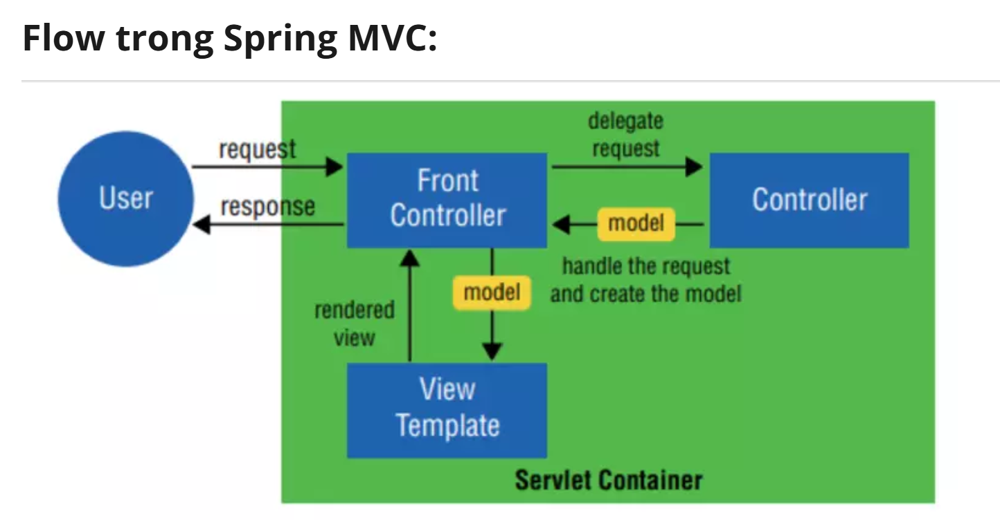

### 1. @Controller
@Controller đánh dấu một class là Controller của Spring MVC

### 2. Thymeleaf
Thymeleaf là template engine

Nó cho phép bạn viết HTML nhưng vẫn có thể lấy dữ liệu từ Java/Spring đưa vào giao diện

Thymeleaf = cầu nối giữa dữ liệu Java/Spring và giao diện HTML

## V. 1 số Annotation trong SpingBoot: @SpringBootApplication, @Component, @Bean, @Autowired

Annotation (chú thích) trong Java là những ký hiệu bắt đầu bằng @, dùng để cung cấp thông tin cho Java hoặc framework biết class/method đó có ý nghĩa hoặc cần được xử lý như thế nào.

### 1. @SpringBootApplication

Đây là "trùm cuối", luôn nằm ở class main. Thực chất , nó là tổ hợp của 3 annotation con:

@Configuration : Khai báo đây là file cấu hình

@EnableAutoConfiguration: Kích hoạt cơ chế tự động cấu hình của Spring Boot (thấy dependency nào thì tự config cái đó)

@ComponentScan: Ra lệnh cho Spring đi "quét" toàn bộ các file trong package hiện tại và các package con để tìm Bean

### 2. @Component

Vai trò: đây là annotation gốc*. Nó đánh dấu một class là một Spring Bean để đưa vào IoC Container quản lý

Khi nào dùng: Dùng cho các class tiện ích, các class cấu hình chung chung không thuộc về tầng Business, Data hay Web

vd: một class gửi email (EmailSender), một class mã hoá mật khẩu (PasswordEncoder)

### 3. @Bean (đi kèm với @Configuration)

Chức năng: Dùng đẻ tạo ra các Bean một cách thủ công

Khi nào dùng?

Khi ta muốn dùng một thư viện bên thứ 3 và muốn Spring quản lý nó. Vì ta không thể mở source code thư viện đó để gắn @Component được, nên phải dùng @Bean. Đặt trên method

```java
@Configuration
public class AppConfig {
    @Bean
    public ModelMapper modelMapper() {
        return new ModelMapper(); // Tự khởi tạo và giao cho Spring quản lý
    }
}
```

### 4. @Autowired

Chức năng: yêu cầu Spring tự động tìm kiếm một Bean có kiểu dữ liệu phù hợp trong Container và tiêm(inject) vào vị trí khai báo.

Cơ chế tìm kiếm:

Theo kiểu dữ liệu : Spring tìm Bean có kiểu dữ liệu phù hợp

Theo tên: nếu có nhiều Bean cùng kiểu, Spring sẽ tìm Bean có tên trùng với tên biến

Các phương pháp @Autowired

Mặc dù @Autowired có thể đặt ở 3 vị trí.

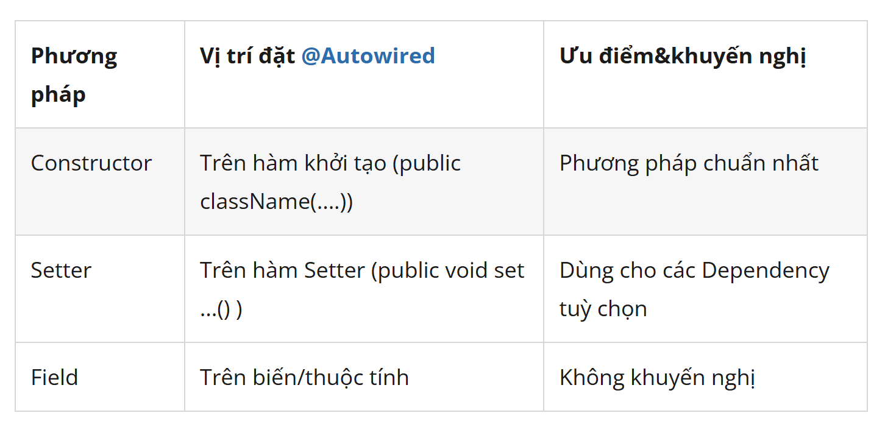

```java
@Service
public class UserService {
    // Nên dùng final để đảm bảo userRepository không bao giờ bị thay đổi
    private final UserRepository userRepository;

    // Spring tự động tiêm Bean UserRepository vào Constructor
    // (Không cần @Autowired)
    public UserService(UserRepository userRepository) { 
        this.userRepository = userRepository;
    }

    // ... code sử dụng userRepository
}
```
## VI. Lombok: @Getter, @Setter, @ToString, @Data, @Builder, @Constructior

Lombok là một thư viện Java giúp giảm rất nhiều code lặp lại (boilerplate code) trong các class, đặc biệt là các class Model/Entity/DTO.

### 1. @Getter & @Setter & @ToString

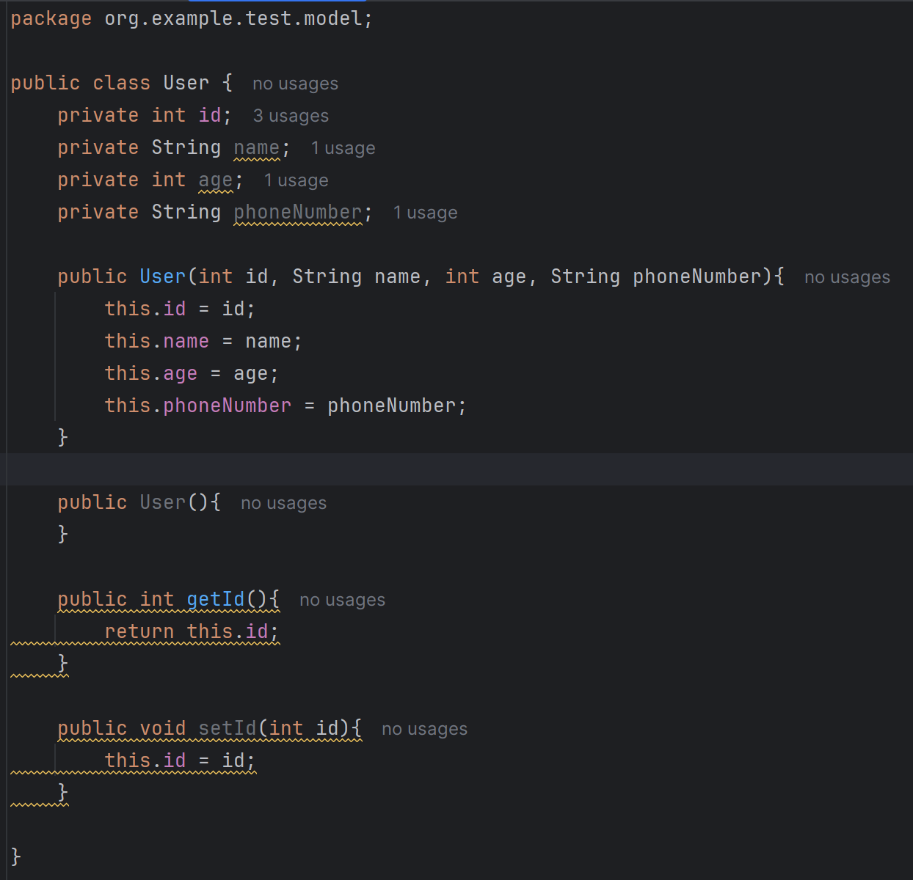
Thay vì phải viết rất nhiều code lặp lại getId, getName, getAge,... 

-> Mình chỉ cần gọi Lombok trước các thuộc tính mà mình khai báo

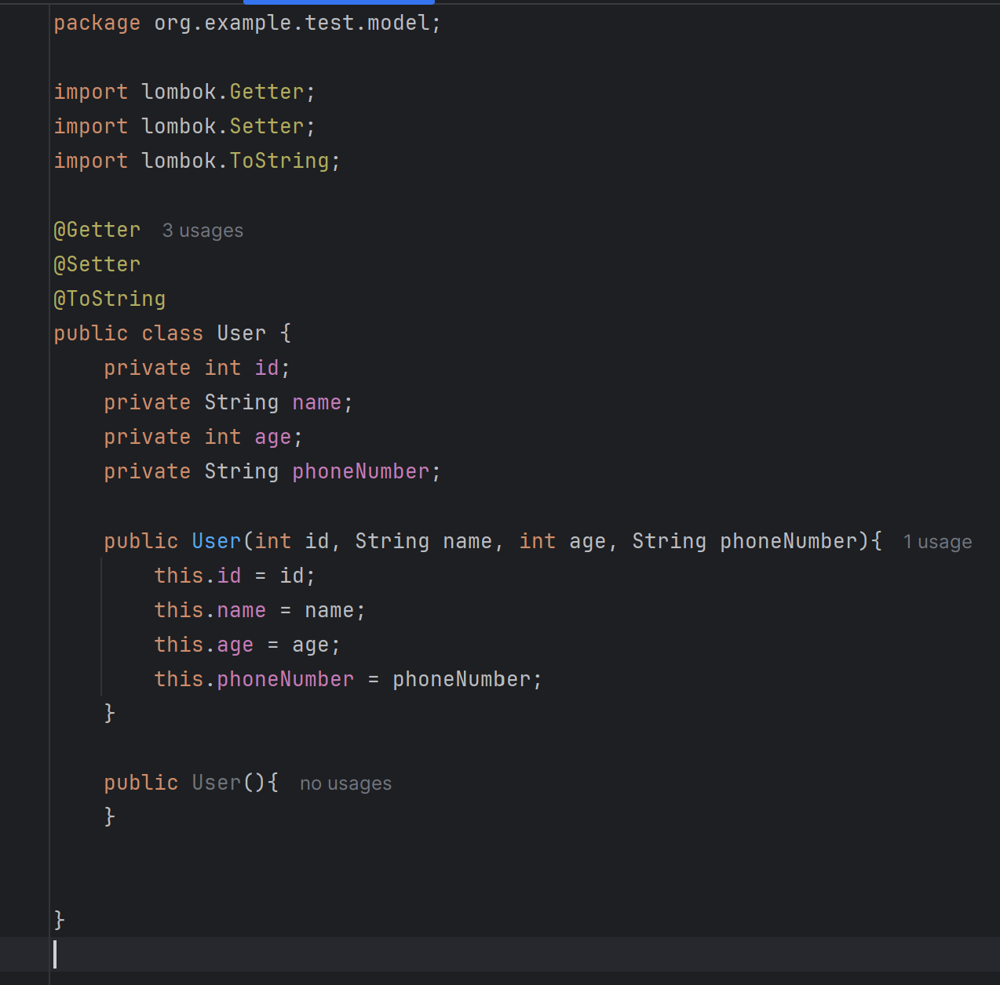

### 2. @Data

Thay vì @Getter, @Setter,... @Data là một annotation tổng hợp cực kỳ tiện lợi. Khi bạn đặt @Data lên đầu class, Lombok sẽ tự động sinh ngầm cho bạn:

Tất cả các hàm Getter và Setter cho các trường.

Phương thức toString().

Phương thức equals() và hashCode().

@RequiredArgsConstructor (constructor cho các trường final)

### 3. @Builder

Ưu điểm vượt trội của @Builder:

Không quan tâm đến thứ tự: Bạn thích điền trường nào trước cũng được (id trước, hay gpa trước, hay email trước đều không ảnh hưởng gì).

Cực kỳ trực quan, dễ đọc: Nhìn vào đoạn code là thấy ngay giá trị này gán cho thuộc tính nào (.gpa(3.65), .email(...)), không sợ bị truyền nhầm dữ liệu.

Linh hoạt: Nếu một đối tượng sinh viên không bắt buộc phải có đủ tất cả các thông tin (ví dụ chưa có email hoặc address), bạn có thể bỏ qua các dòng đó mà không cần phải viết một đống constructor quá tải (overloaded constructors) khác nhau.

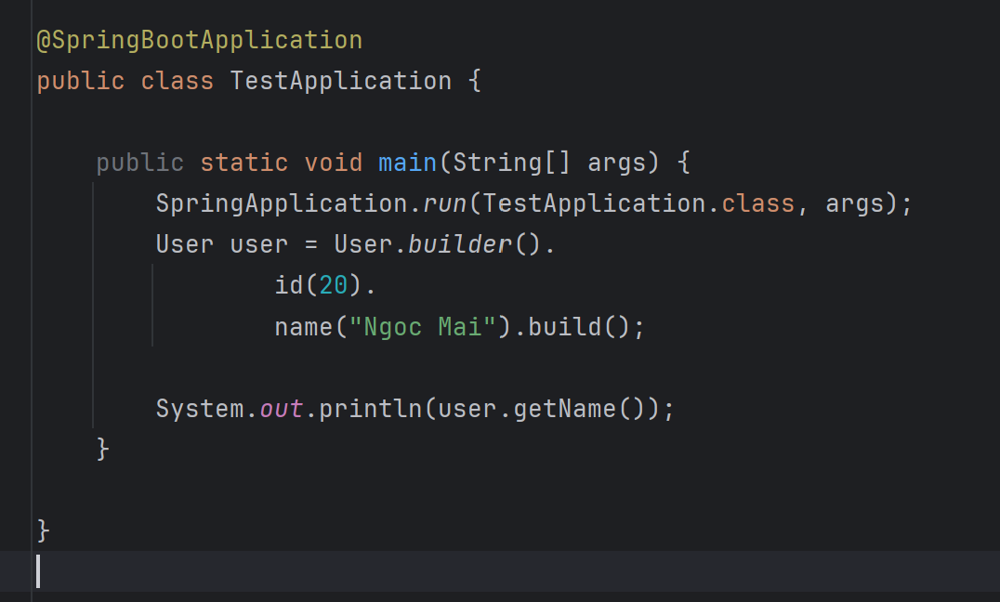
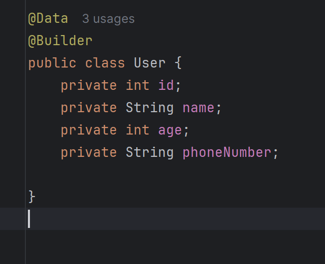

### 4. @Constructior 
Trong Lombok không có annotation nào tên là @Constructior, thay vào đó chúng được chia thành các loại cụ thể tùy theo nhu cầu sử dụng:

@NoArgsConstructor: Tự động tạo một constructor rỗng (không có tham số nào), ví dụ: public User() {}.

@AllArgsConstructor: Tự động tạo một constructor đầy đủ tham số bao gồm tất cả các trường có trong class.

@RequiredArgsConstructor: Tạo constructor chỉ cho các trường bắt buộc (những trường có gắn từ khóa final hoặc @NonNull).
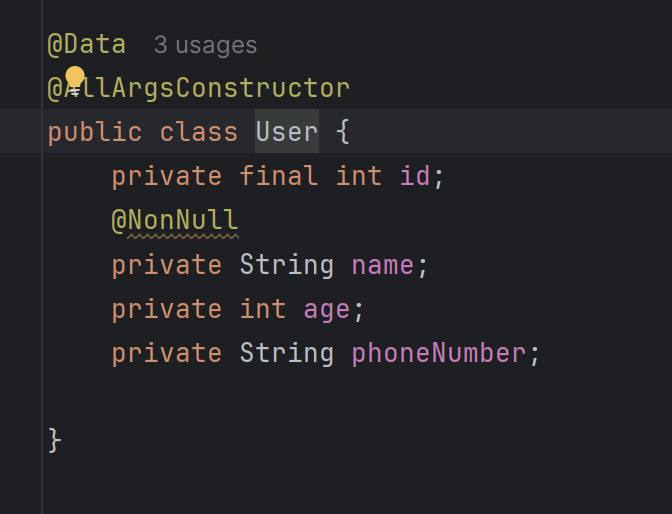
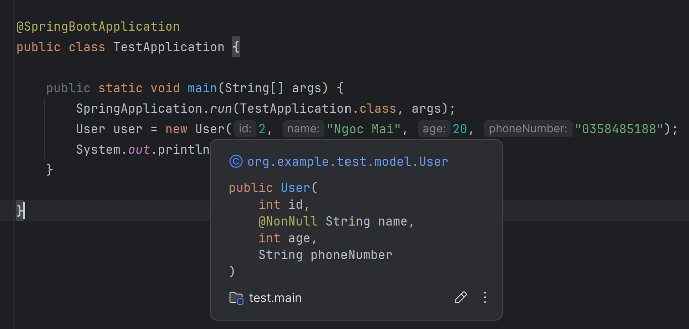

## VII. Log trong SpringBoot : Log4j là gì và Antotation @Slf4j

Log (hay file log, nhật ký ứng dụng) là một bản ghi tự động lưu lại các sự kiện, hoạt động, trạng thái, hoặc lỗi xảy ra trong một hệ thống phần mềm hoặc ứng dụng trong suốt quá trình chạy.

Hãy hình dung log giống như hộp đen của máy bay hoặc nhật ký hành trình của ứng dụng. Khi có sự cố xảy ra, lập trình viên sẽ dựa vào log để biết chính xác lỗi xuất phát từ đâu và xảy ra vào lúc nào.

Các thành phần chính của Log
Một dòng log tiêu chuẩn thường bao gồm các thông tin quan trọng sau:

Timestamp: Thời gian chính xác (đến từng mili-giây) sự kiện xảy ra.

Log Level (Cấp độ log): Mức độ quan trọng của thông điệp (ví dụ: INFO, ERROR, DEBUG).

Thread Name: Tên luồng (thread) thực thi đoạn code đó.

Logger Name / Class: Tên class hoặc component đã tạo ra dòng log.

Message: Nội dung thông báo cụ thể hoặc kèm theo stack trace khi có lỗi.

### 1. Log4j là gì

***Log4j (hoặc phiên bản cải tiến Log4j2) là một thư viện mã nguồn mở rất phổ biến trong ngôn ngữ lập trình Java, dùng để ghi log (nhật ký ứng dụng).***

Thay vì sử dụng lệnh System.out.println() để in thông báo ra màn hình console (cách làm không chuyên nghiệp và khó quản lý), các lập trình viên sử dụng Log4j để kiểm soát việc lưu trữ thông tin, cảnh báo, và lỗi của ứng dụng một cách chuyên nghiệp hơn.

* Các tính năng nổi bật của log4j:

Phân loại cấp độ log (Log Levels): Cho phép bạn lọc thông tin theo mức độ quan trọng như DEBUG (không ảnh hưởng), INFO (thông tin bình thường), WARN (Cảnh báo - có rủi ro nhưng chưa có lỗi), ERROR (có lỗi ảnh hưởng), FATAL (sập hệ thống). 

Ví dụ, khi ứng dụng chạy thực tế (production), bạn có thể ẩn các log DEBUG đi để tiết kiệm tài nguyên và chỉ ghi lại các log từ mức INFO hoặc ERROR trở lên.

### 2. @Slf4j 

@Slf4j là một annotation (chú thích) thuộc thư viện Project Lombok trong Java.

Nó được đặt lên trên đầu tên một Class với mục đích tự động tạo ra một biến Logger giúp bạn, tiết kiệm công sức không phải viết code thủ công.

Khi không có @Slf4j -> code thủ công:
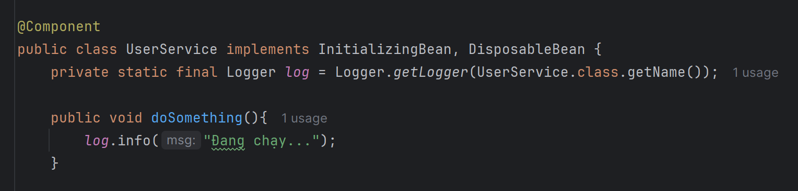
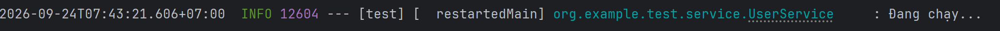

Dùng @Slf4j để dùng luôn log.
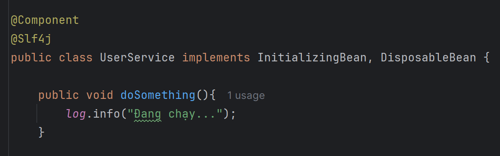
